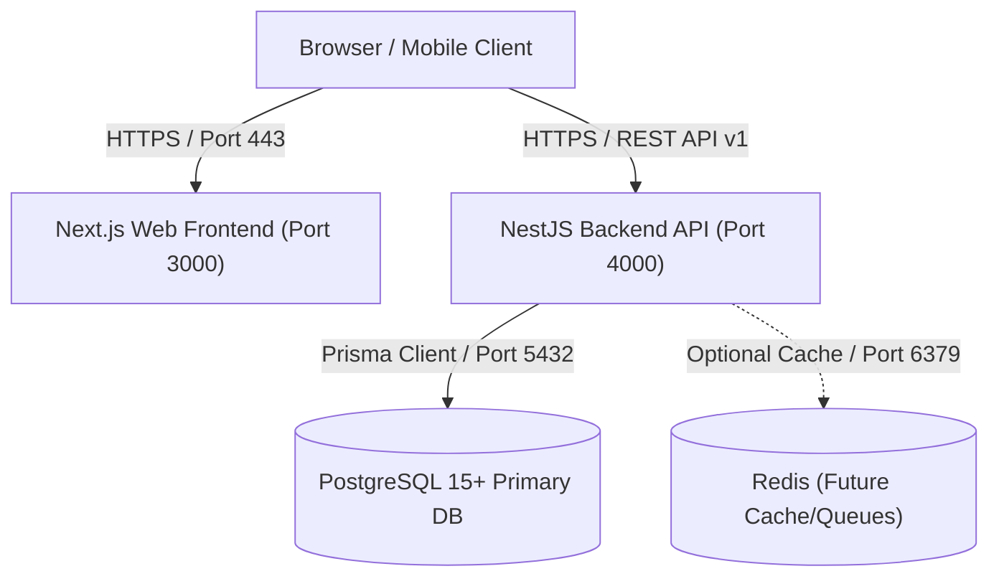

# Wierd Social Food Evolution Platform — Launch Checklist & Production Runbook

## Overview

This document is the operational guide and pre-flight checklist for deploying the Wierd Social Food Evolution Platform to staging and production environments.

---

## 1. Verified System Architecture



### Components

1. **Frontend (`apps/web`)**: Next.js 14 App Router, TypeScript, Tailwind CSS, Lucide icons.
2. **Backend API (`apps/api`)**: NestJS 10, TypeScript, Prisma ORM, Passport JWT, Zod validation pipes, sanitized exception filters.
3. **Database**: PostgreSQL 15+ (relational storage with foreign key constraints, indexes, and unique compound constraints).
4. **Shared Packages (`packages/`)**:
   - `@food-evolution/types`: Core TypeScript domain interfaces.
   - `@food-evolution/validation`: Shared Zod validation schemas for forms and API contracts.
5. **Redis Cache (Optional / Non-blocking)**: Provisioned in local docker infra for future caching and task queues; currently idle and **not** a hard runtime blocker for application functionality.

---

## 2. Production Environment Variables Reference

> [!CAUTION]
> Never commit actual secret strings or production credentials into source control. All production values must be injected securely via platform secrets management (e.g. AWS Secrets Manager, GitHub Secrets, or Kubernetes Secrets).

### Backend API (`apps/api`)

| Variable Name    |   Required   | Description                                                                                                     | Example / Allowed Values                                                     |
| :--------------- | :----------: | :-------------------------------------------------------------------------------------------------------------- | :--------------------------------------------------------------------------- |
| `PORT`           |   Optional   | HTTP port the NestJS server listens on. Defaults to `4000`.                                                     | `4000` or `$PORT`                                                            |
| `NODE_ENV`       | **Required** | Runtime environment mode. Enforces strict production validation.                                                | `production`                                                                 |
| `DATABASE_URL`   | **Required** | PostgreSQL connection string with authentication and TLS.                                                       | `postgresql://<user>:<pwd>@<host>:<port>/<db>?schema=public&sslmode=require` |
| `JWT_SECRET`     | **Required** | Cryptographically secure random secret (>= 32 characters / 256 bits). Fails fast if default dev secret is used. | External high-entropy secret string                                          |
| `JWT_EXPIRES_IN` |   Optional   | JWT authentication token validity duration. Defaults to `7d`.                                                   | `7d`, `24h`                                                                  |
| `CORS_ORIGIN`    | **Required** | Comma-delimited list of allowed frontend origins. Wildcard `*` is prohibited when credentials are enabled.      | `https://wierd.food,https://app.wierd.food`                                  |
| `REDIS_URL`      |   Optional   | Redis connection URL for future caching/queues. Currently non-blocking.                                         | `rediss://<host>:6380`                                                       |

### Frontend Web Client (`apps/web`)

| Variable Name            |   Required   | Description                                                 | Example / Allowed Values        |
| :----------------------- | :----------: | :---------------------------------------------------------- | :------------------------------ |
| `NODE_ENV`               | **Required** | Next.js runtime environment mode.                           | `production`                    |
| `PORT`                   |   Optional   | Listening port for Next.js HTTP server. Defaults to `3000`. | `3000` or `$PORT`               |
| `NEXT_PUBLIC_API_URL`    | **Required** | Public HTTPS endpoint for the backend API v1.               | `https://api.wierd.food/api/v1` |
| `NEXT_PUBLIC_HEALTH_URL` | **Required** | Public HTTPS health probe for connectivity indicator.       | `https://api.wierd.food/health` |

---

## 3. Production Deployment Procedures

### A. Independent Service Deployment

The frontend and backend API are decoupled and can be deployed to separate hosts or platforms:

- **Backend API**: Can run on AWS ECS, GCP Cloud Run, Render, Fly.io, or Railway.
- **Frontend Web**: Can run on Vercel, Cloudflare Pages / Workers, AWS Amplify, or a Docker container.

### B. Database Migration Procedure

> [!IMPORTANT]
> In production environments, **always** use `prisma migrate deploy`. Never use `prisma migrate dev`, as it can trigger interactive database resets.

```bash
# 1. Navigate to the API workspace
cd apps/api

# 2. Run pending production migrations
npx prisma migrate deploy

# 3. Verify migration status
npx prisma migrate status

# 4. (Optional initial setup only) Seed canonical ingredients
npx prisma db seed
```

### C. Build & Startup Commands

#### Backend API (`apps/api`)

```bash
# Install dependencies (from monorepo root)
npm ci

# Build shared packages
npm run build --workspace=@food-evolution/types
npm run build --workspace=@food-evolution/validation

# Build API application
cd apps/api
npm run build # or npx nest build

# Start production server
npm run start # executes: node dist/src/main.js
```

#### Frontend Web (`apps/web`)

```bash
# Build web application (from apps/web)
cd apps/web
npm run build # executes: next build

# Start production server
npm run start # executes: next start -p 3000
```

---

## 4. Health Checks, Probes & Shutdown

### Liveness Probe (API)

- **URL**: `GET /health` (version-neutral, unauthenticated)
- **Response**: HTTP 200 OK

```json
{
  "status": "ok",
  "service": "food-evolution-api",
  "timestamp": "2026-10-18T02:00:00.000Z",
  "uptime": 1234.56
}
```

### Readiness & Database Connection (API)

- On application bootstrap, `PrismaService.onModuleInit()` calls `$connect()`. If PostgreSQL is unreachable or credentials are bad, the process throws an error and exits immediately, preventing broken pods from receiving traffic.

### Graceful Shutdown

- `app.enableShutdownHooks()` is active in `main.ts`. Upon receiving `SIGINT` or `SIGTERM`, NestJS finishes active requests and cleanly disconnects Prisma database connection pools.

---

## 5. Database Backup and Disaster Recovery

### Standard Automated Backup (PostgreSQL)

Run periodically (e.g. hourly or daily via cron / cloud scheduler):

```bash
# Logical compressed dump
pg_dump -h "${DB_HOST}" -p "${DB_PORT:-5432}" -U "${DB_USER}" -d "${DB_NAME}" -F c -b -v -f "/backups/wierd_db_$(date +%Y%m%d_%H%M%S).dump"
```

### Restore Procedure

```bash
# Restore to database instance
pg_restore -h "${DB_HOST}" -p "${DB_PORT:-5432}" -U "${DB_USER}" -d "${DB_NAME}" -v --clean --if-exists "/backups/<BACKUP_FILENAME>.dump"
```

---

## 6. Pre-Launch Developer Checklist

Execute and check off each item prior to cutting a production release:

### Codebase & Hygiene

- [x] All `.env*` files containing secrets are git-ignored; only sanitized `.env.example` templates exist.
- [x] No plaintext passwords, database credentials, or secret keys appear in Git history.
- [x] Sensitive user fields (`passwordHash`, `email`) are stripped from all public DTO responses.
- [x] Moderation invariant enforced: `safetyStatus === 'BLOCKED'` experiments cannot be viewed, remixed, voted on, or receive cooking results.
- [x] Media URLs strictly require `http://` or `https://` schemes.

### Verification Suites

- [x] All API unit tests pass (`npm test` in `apps/api` — 18 suites, 157 tests).
- [x] All Frontend unit tests pass (`npm test` in `apps/web` — 18 suites, 123 tests).
- [x] All API E2E tests pass (`npm run test:e2e` in `apps/api` — 8 suites, 104 tests).
- [x] TypeScript typechecks pass cleanly with 0 errors across all workspaces.
- [x] Prettier code formatting verified across all workspaces.
- [x] Production builds pass cleanly (`npx nest build` and `npm run build`).
- [x] 13 Core User Journeys pass end-to-end (`node tests/step31-core-journeys.js`).
- [x] 17 Critical Edge Cases pass (`node tests/step32-edge-cases.js`).

---

## 7. Remaining External Infrastructure Requirements

Before opening the platform to public internet traffic, the following cloud/infrastructure services require setup by the platform operator:

1. **Managed Database (PostgreSQL 15+)**:
   - Provision hosted PostgreSQL (e.g. AWS RDS, Supabase, Neon, or Railway) with TLS enabled (`sslmode=require`).
   - Run `npx prisma migrate deploy` and `npx prisma db seed`.
2. **Domain & TLS Certificates**:
   - Configure DNS records for the frontend (`wierd.food`) and API (`api.wierd.food`).
   - Provision automated SSL/TLS certificates (Cloudflare or Let's Encrypt).
3. **Rate Limiting & Abuse Prevention**:
   - Implement reverse proxy or edge rate limiting (Cloudflare WAF or `@nestjs/throttler`) to limit brute-force attempts on `/api/v1/auth/login` and `/api/v1/auth/register`.
4. **Direct File Upload Storage (Future Feature)**:
   - Cooking proof media currently accepts verified image URLs (`https://...`). If direct browser upload is desired, configure an AWS S3 bucket / Cloudinary service with presigned upload URLs.
5. **Application Monitoring & Error Tracking**:
   - Integrate Sentry or Datadog for centralized exception tracking and performance telemetry in production.
